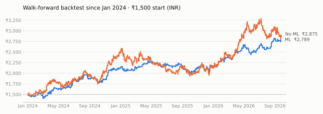

# BTC 9/15 EMA Scalper + ML · forward test

Paper-trading forward test of the **"9/15 EMA Scalper Strategy v3"** (TradingView Pine, uzairblaoch) on
**Delta Exchange India BTCUSD perpetual**, 5-minute candles, with a LightGBM filter that keeps only the
highest-probability 35% of signals. Runs automatically on GitHub Actions and rewrites this page after
every trade.

**Mode:** paper trading · **Last update:** 28 Sep 2026, 18:00 IST · **Data:** delta:BTCUSD · **Model:** trained 2026-09-28, cut p ≥ 0.441 · **Open positions:** none

> ⚠️ Paper trading only. No orders are sent to any exchange. Past and simulated results do not
> guarantee future returns. Read [Limitations](#limitations) before trusting any number here.

**Reports** (open in a browser once GitHub Pages is enabled, see [Repository layout](#repository-layout)):
[realistic equity outlook (start here)](https://10vulture1005.github.io/btcbot/realistic.html) ·
[backtest at the bot's settings + monthly SIP](https://10vulture1005.github.io/btcbot/backtest_50x.html) ·
[what 100x / 200x leverage does](https://10vulture1005.github.io/btcbot/leverage.html)

## Schedule (Indian Standard Time)

| Session | Entries (IST) | Entries (UTC) | Bot running (IST) | Days |
|---|---|---|---|---|
| London | 13:30 – 17:30 | 08:00 – 12:00 | ~12:50 – 18:00 | Mon – Fri |
| New York | 18:30 – 22:30 | 13:00 – 17:00 | ~18:00 – 23:00 | Mon – Fri |

No trading on Saturday and Sunday. IST has no daylight saving, so these times never shift.
Every position is closed at most **25 minutes** after entry, so every trade qualifies for Delta's
fee-free rule (closed within 30 minutes).

## Forward test

_No forward-test trades yet. The bot trades Monday–Friday, London 13:30–17:30 IST and New York 18:30–22:30 IST; results appear here after the first closed trade._

## Backtest reference (what the forward test should look like)

Walk-forward 2021-01 → 2026-09: the model is retrained every month on past data only and scores the next month. Out-of-sample AUC 0.588 (since 2024: 0.585). Same fills as the bot's candle model, zero slippage, whole Delta contracts from ₹1,500.

| Backtest | Trades | Per month | Win rate | Avg R | Profit factor | ₹1,500 → | Max DD |
| --- | ---: | ---: | ---: | ---: | ---: | ---: | ---: |
| ML filter (top 35%), Jan 2024 → | 501 | 15 | 52.5% | +0.11R | 1.22 | ₹2,789 | 12.4% |
| No ML (Pine rules), Jan 2024 → | 1357 | 41 | 43.8% | +0.05R | 1.09 | ₹2,875 | 25.9% |
| ML filter (top 35%), Jan 2021 → | 1015 | 15 | 53.8% | +0.16R | 1.34 | ₹4,558 | 15.2% |
| No ML (Pine rules), Jan 2021 → | 2860 | 42 | 44.6% | +0.09R | 1.17 | ₹10,588 | 34.2% |

| Year | ML avg R | ML win rate | No-ML avg R | No-ML win rate |
| --- | ---: | ---: | ---: | ---: |
| 2021 | +0.18R | 55.2% | +0.11R | 46.4% |
| 2022 | +0.33R | 61.1% | +0.22R | 48.3% |
| 2023 | +0.12R | 50.3% | +0.06R | 41.8% |
| 2024 | +0.13R | 52.5% | +0.10R | 45.3% |
| 2025 | -0.04R | 48.3% | -0.06R | 40.4% |
| 2026 | +0.26R | 58.0% | +0.11R | 45.7% |

<picture>
  <source media="(prefers-color-scheme: dark)" srcset="charts/backtest_equity_dark.svg">
  
</picture>

## Limitations

The backtest numbers are the optimistic end of what to expect. In order of importance:

1. **It only works because of Delta India's fee-free rule** for trades closed within 30 minutes. With normal
   fees (0.05% taker, 0.02% maker) the same trades lose about 0.4R each: ₹1,500 → ₹292 since 2024. If Delta
   ends or changes the rule, stop the bot.
2. **The edge is small and uncertain:** about +0.11R per trade since 2024 (± 0.055R, one standard error,
   ~500 trades). Probably real, but an edge close to zero is not ruled out.
3. **Hindsight in the design.** This strategy survived out of about 20 BTC strategies tested on the same data,
   and the weekday filter, top-35% cut, 2R target and session hours were chosen after seeing the full history.
   The monthly walk-forward stops the *model* seeing the future, not these choices.
4. **Recent years are weaker** than 2021–2023, and 2025 was flat to negative (average trade below zero).
5. **ML mainly smooths the ride.** Over the full history the No-ML version made more money (3× the trades) with
   more than twice the drawdown.
6. **Slippage is not in the headline numbers.** At 0.002% per fill the 2024+ result drops from ₹2,789 to
   ₹2,526, and at 0.005% to ₹2,309. The live-price columns above measure the real figure.
7. Backtest candles are Binance BTCUSDT; the bot trades Delta BTCUSD (close, not identical). Funding, outages,
   API errors and late GitHub starts are not modelled; 1-lot rounding makes real risk 0.5–2% on a given trade.

## Strategy

| | Rule |
|---|---|
| Timeframe | 5 minutes, BTCUSD perpetual |
| Trend | EMA 9 above/below EMA 15, EMA 9 sloping ≥ 0.3 pts over 3 bars, gap ≥ 0.5 pts |
| Normal entry | EMA 9 inside the candle body + strong candle (body ≥ 60%, small opposite wick), pin bar or engulfing |
| FVG entry | Displacement candle (body > 2× 20-bar average, touching an EMA, in trend); next bar retraces 30–70% of it without breaking its extreme |
| 1h bias | 1h EMA 9 vs 15, 1h EMA 9 slope over 5 bars, 1h close on the right side |
| Stop / target | Signal candle low/high ∓ 1 pt · target 2R ∓ 1 pt |
| Exit | Stop, target, or market exit 25 minutes after entry |
| ML filter | LightGBM P(win) from ~50 OHLCV features (multi-timeframe trend, volatility, candle shape, stop size, session); trade only if p ≥ cut. Cut = 65th percentile of recent signals (keeps the top 35%). Retrained monthly on the full Binance BTCUSDT 5m history. |
| Days / hours | Monday – Friday, London 13:30–17:30 IST and New York 18:30–22:30 IST |

**Two paper accounts** trade side by side: *ML filter* (the strategy) and *No ML* (every signal the Pine
rules take), so the forward test shows whether the model adds value.

**Two prices per trade:**
- *Candle model*: filled exactly as in the backtest, at the next 5-minute open, with stop and target taken from candle highs/lows.
- *Live prices*: Delta's actual best bid/ask when the order would be sent, and the price seen when the stop or target triggers (checked every second).

The gap between the two is the slippage the backtest cannot see.

### Position sizing (Delta Exchange India)

| | |
|---|---|
| Contract | BTCUSD perpetual, 1 lot = 0.001 BTC, minimum 1 lot, tick 0.5 |
| Capital | ₹1,500 per paper account (USD/INR fixed at ₹85 by Delta India) |
| Risk | whole lots for 1% of equity; 1 lot if that rounds to 0 but risks ≤ 2%, otherwise skip |
| Fees | 0 (every trade closes within 30 min); standard 0.02% maker / 0.05% taker otherwise |
| Margin | **50× cross margin**. 1 lot locks ≈ ₹125; liquidation stays ≥ 20% away vs a ~0.27% stop. Lots are capped so liquidation is always ≥ 2× farther than the stop. |
| Why not 100×/200× | At fixed 1% risk, leverage changes the margin locked, not profit: 50×, 100× and 200× cross give the same ₹1,500 → ₹2,789 (2024–26 backtest). 200× **isolated** liquidates after a 0.25% move, closer than most stops: ₹890 with 69 liquidations. Using the leverage for bigger positions (all-in 100×/200×) wiped the account within weeks. |

## Live trading (on your own machine)

Delta India API keys with trading permission only work from **whitelisted IPs**, so live trading runs on your
machine, not on GitHub. Only the ML signals are traded; every entry carries a stop-loss and take-profit at Delta.

1. Put your key in `btcbot\.env` (outside this repo) or `ema915-forward\.env` (git-ignored); see `.env.example`.
   `LIVE_TRADING=yes` sends real orders, anything else is a dry run. `TEST_MODE=yes` is for a tiny balance:
   always 1 lot, 100x cross, max 3 trades a day.
2. Whitelist your current IPv4 on the key, then `python live.py check` (read-only; shows the IP Delta sees).
3. `python bot.py --live --all-day` (or double-click `run_live.bat`) trades today's London and New York sessions.
4. Emergency: `python live.py flatten --yes` cancels all BTCUSD orders and closes the position.

Logs (git-ignored): `logs/live_YYYY-MM-DD.log` (every API call and decision, IST), `logs/live_orders.csv`,
`logs/live_trades.csv` (fills, fees, slippage, R, P&L in ₹). Test: `python tests/test_live_mock.py`.

## Pine Script (TradingView)

[`pine/ema915_v3_london_ny.pine`](pine/ema915_v3_london_ny.pine) is the same rules for TradingView's
Strategy Tester: IST sessions, Monday–Friday, 25-minute exit, 1% risk sizing, zero commission. Open a
`BINANCE:BTCUSDT.P` or `DELTAIN:BTCUSD.P` 5-minute chart, paste the script into the Pine Editor, and click
**Add to chart**. The ML filter cannot run inside Pine, so the TradingView backtest corresponds to the
**No ML** account.

## How it runs

| Workflow | When (IST) | What |
|---|---|---|
| `session.yml` | Mon–Fri ~12:50 and ~18:10 | Runs `bot.py` for the London or New York session (≈ 5 h each), commits `state/`, `charts/`, `README.md` after every trade |
| `retrain.yml` | 1st of each month, 08:30 | Downloads new Binance 5m candles, retrains the model, rebuilds the reports, commits `model/`, `data/`, `docs/` |

## Repository layout

| Path | What |
|---|---|
| `bot.py` | The paper-trading bot (run by `session.yml`) |
| `strategy.py` | Rules, sizing (Delta lots, 1% risk, 50x cross), features, trade simulation. One code path for backtest and bot |
| `train.py` | Updates price history, walk-forward backtest, trains the live model (run by `retrain.yml`) |
| `report.py`, `README_TEMPLATE.md` | Build this README and `charts/` |
| `model/` | Live model, its cutoff, walk-forward trades and summary |
| `state/` | Forward-test log: `trades.csv`, `signals.csv`, `runs.csv`, `state.json` |
| `data/5m/` | Binance BTCUSDT 5-minute history, one file per month |
| `research/` | Leverage study, the 50x/SIP backtest page and the realistic outlook (`templates/` holds the HTML) |
| `docs/` | The HTML reports. Enable **Settings → Pages → Deploy from branch → `main` / `docs`** to view them at `https://10vulture1005.github.io/btcbot/` |
| `tests/` | Bot-vs-backtest parity, live-quote path, SIP maths |
| `pine/` | TradingView version (No-ML rules) |
| `live.py`, `run_live.bat` | Live trading on Delta from your machine (see above) |

Run locally: `pip install -r requirements.txt`, then

| Command | Does |
|---|---|
| `python bot.py` | Paper-trade the current session |
| `python report.py` | Rebuild this README |
| `python train.py --walkforward` | Update data, re-run the walk-forward backtest, retrain |
| `python research/backtest50_report.py` | Rebuild `docs/backtest_50x.html` |
| `python research/leverage_report.py` | Rebuild `docs/leverage.html` |
| `python research/realistic_report.py` | Rebuild `docs/realistic.html` (realistic costs + 12-month outlook) |
| `python tests/test_parity.py 2026-09-01 2026-09-27` | Bot vs backtest on history |
| `python tests/test_live_path.py 2026-09-01 2026-09-27` | Live-quote code path on history |
| `node tests/test_sip.js` | SIP maths in the page vs Python |

**Note:** the two session jobs use about 300 runner-hours a month. That's free on a **public**
repository; on a private repository it is far beyond the free 2,000 minutes.
